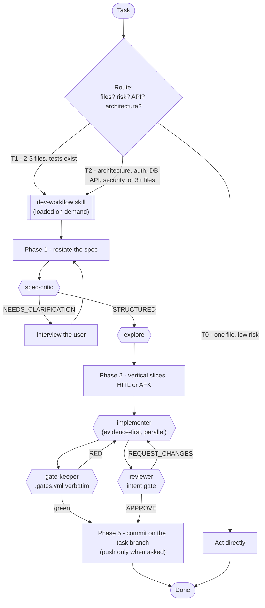

# agent-workflow

Claude Code marketplace for a multi-agent development workflow (opencode support unmaintained),
with two independent plugins:

- `agent-workflow`: task routing, agent roster, enforceable gates.
- `shunt`: token-shunt hook and cheap `bulk-reader` / `code-writer` agents.

## Why

- **Route before working.** A typo must not pay for a spec, a critic and two gate runs.
- **Load rules on demand.** Only the skill and agent descriptions are always on; the
  routing table and five phases (~2300 tokens) load when a task routes T1/T2.
- **Cheap models read, the expensive one decides.** The `shunt` plugin redirects large reads
  to subagents; reasoning stays on the primary model.
- **Two gates.** `.gates.yml` proves the code runs; the reviewer proves it does what was
  asked. Green tests on the wrong feature is a failed task.
- **Evidence before code.** Every brief names its proof form (TDD, suite green, manual QA).
- **Gates are data, not prompts.** `.gates.yml` runs verbatim in CI and under an agent
  that never interprets results.

## Workflow



| Level | Trigger | Process |
|---|---|---|
| **T0** | 1 file, low risk, no API surface | act directly |
| **T1** | 2-3 files, existing tests prove it | `dev-workflow` skill |
| **T2** | architecture, auth, DB, API, security, or 3+ files with new behavior | `dev-workflow` skill |

In doubt, route one level up. Trigger criteria live in the skill description, the table
and phases in `plugins/agent-workflow/skills/dev-workflow/SKILL.md`.

## Install

```powershell
claude plugin marketplace add TheElysium/agent-workflow
claude plugin install agent-workflow@agent-workflow
claude plugin install shunt@agent-workflow
```

Each plugin installs and works alone. Restart running sessions after install or update.
Skill: `/agent-workflow:dev-workflow`; agents: `agent-workflow:<name>`, `shunt:bulk-reader`,
`shunt:code-writer`.

Not shippable in a plugin — add by hand to `~/.claude/settings.json` if wanted:

```json
"permissions": { "ask": ["Bash(git push:*)", "Bash(git push)"] },
"statusLine": { "type": "command", "command": "pwsh -NoProfile -File C:/path/to/statusline-command.ps1" }
```

`statusline-command.ps1` is in `.claude/` of a clone of this repo (not installed by the plugin).

Per project: create `.gates.yml` at the root (format in `plugins/agent-workflow/skills/dev-workflow/gates.md`),
optionally `.claude/stacks/<stack>.md`. Plugin agents cannot be overridden by a same-name
project agent: a project `.claude/agents/<name>.md` is a separate agent.

### Develop

- Test local changes without installing: `claude --plugin-dir C:/path/to/agent-workflow/plugins/<plugin>`,
  `/reload-plugins` after edits.
- Every merge to `main` touching a plugin bumps `version` in that plugin's `.claude-plugin/plugin.json`;
  installed copies only update on a new version (`claude plugin update <plugin>`).
- Validate: `claude plugin validate plugins/<plugin> --strict` and `claude plugin validate .`.

### Rollback

```powershell
claude plugin uninstall agent-workflow
claude plugin uninstall shunt
claude plugin marketplace remove agent-workflow
```

## Layout

```
.claude-plugin/marketplace.json               marketplace `agent-workflow`: plugins agent-workflow, shunt
plugins/agent-workflow/.claude-plugin/        plugin.json manifest (name, version)
plugins/agent-workflow/agents/                implementer reviewer gate-keeper explore spec-critic
plugins/agent-workflow/skills/dev-workflow/   routing + 5 phases + multi-agent rules; gates.md, ui.md,
                                              metrics.md read when triggered
plugins/agent-workflow/hooks/                 hooks.json (SessionEnd), session-end.ps1 (usage import)
plugins/agent-workflow/scripts/               review-checklist, usage-report, usage-import-claude, session-tools
plugins/shunt/.claude-plugin/                 plugin.json manifest (name, version)
plugins/shunt/agents/                         bulk-reader code-writer
plugins/shunt/hooks/                          hooks.json (PreToolUse), shunt.ps1
plugins/shunt/scripts/                        shunt-report
plugins/**/*.Tests.ps1                        Pester, next to the file under test;
                                              plugins/plugins.Tests.ps1 guards manifests and paths per plugin
AGENTS.md                                     this repo's rules only. CLAUDE.md = one line @AGENTS.md
.claude/settings.json                         this repo: permissions, statusLine   settings.local.json  never committed
.claude/stacks/<stack>.md                     per-project stack traps, one line each, path passed to implementer + reviewer
.opencode/                                    unmaintained: roster, shunt.ts, usage-log.ts, bun tests; outside gates and CI
scripts/run-gates.ps1                         executes .gates.yml (gate-keeper + CI)
.gates.yml                                    lint / test / sast
PSScriptAnalyzerSettings.psd1                 lint rules for the .ps1 gate
.github/ githooks/                            this repo's own CI and self-gate, not shipped
```

## Gates

- `.gates.yml` at every project root is the single source of gate commands (format
  documented in `plugins/agent-workflow/skills/dev-workflow/gates.md`); `gate-keeper` runs it verbatim.
  Missing file -> built with the user, never guessed.
- A generated skeleton emits unfillable gates as hard reds
  (`echo "gate not configured" >&2 && exit 1`). A green run proving nothing is worse than none.
- SAST is non-skippable. A run without it is a red gate. Missing tool = FAIL, never skip.
- Local-only by default; CI optional. Long tasks persist state in `docs/tasks/<slug>.md`.
- This repo self-gates: `git config core.hooksPath githooks` (PSScriptAnalyzer, secrets,
  accents, JSON, `CLAUDE.md == @AGENTS.md`); `githooks/pre-commit` is a sh shim to
  `pre-commit.ps1`.

## Dependencies

| Tool | Needed by | Notes |
|---|---|---|
| PowerShell 7.5+ (`pwsh`) | hooks, statusline, scripts, gates | `winget install Microsoft.PowerShell` |
| PSScriptAnalyzer 1.25.0, Pester 6.2.0 | lint + test gates, self-gate | `Install-Module <name> -RequiredVersion <v> -Scope CurrentUser` |
| `gitleaks` | sast gate, self-gate | missing gate tool = hard red |
| `bun` | opencode plugins only (unmaintained) | `bun install` in `.opencode/` |

## Telemetry

- **Shunt**: `shunt.ts` (opencode) and `shunt.ps1` (Claude), same thresholds - 350 lines /
  65536 bytes, tunable with `SHUNT_MIN_LINES` / `SHUNT_MAX_BYTES`. Divergences: exactly
  350 lines passes on the Claude side (counts `\n`), blocked on the opencode side (counts the
  trailing newline); `verb/foo.txt` with no trailing space is blocked opencode-side only.
  Claude flags subagent calls with a top-level `agent_id`. MSYS drive paths (`/c/...`) in
  Bash-tool commands resolve to `C:\...`.
- **Sink**: hooks write to `.usage/` in the project root; each plugin creates it on its own.
  A `.usage/` created by either plugin holds a `.gitignore` with `*`.
  Purge with `Remove-Item -Recurse .usage`.
- **Shunt log**: every decision (allow and deny) appends one JSONL line to
  `.usage/shunt.jsonl`. Schema: `ts` `harness` `session` `tool` `decision` `reason` `path`
  `bytes` `lines` `threshold_bytes` `threshold_lines`, plus `command` (bash) or
  `offset`/`limit` (read); records with no `decision` are legacy denies. One record per
  file arg. Best-effort: a write failure never blocks the redirect. Aggregate with
  `plugins/shunt/scripts/shunt-report.ps1`. Never rotated.
- **Usage**: SessionEnd imports main and subagent transcripts
  (`<session>/subagents/agent-*.jsonl`) into `.usage/usage.jsonl`; unchanged files are skipped
  by mtime. First run on a large history may exceed the 10 s hook timeout (progress is kept):
  `pwsh -NoProfile -File <plugin>/scripts/usage-import-claude.ps1 --project <slug> --out .usage/usage.jsonl`
  (`<plugin>` = installed agent-workflow root under `~/.claude/plugins/cache/`, or `plugins/agent-workflow/` of a clone).
- **Accepted divergences**: `hidden`/`temperature` opencode-only; `effort` Claude-only, so
  model tiers are set independently; detailed permissions opencode-only. opencode no longer
  discovers the skill (moved under `plugins/agent-workflow/`).

## License

MIT - see `LICENSE`.
